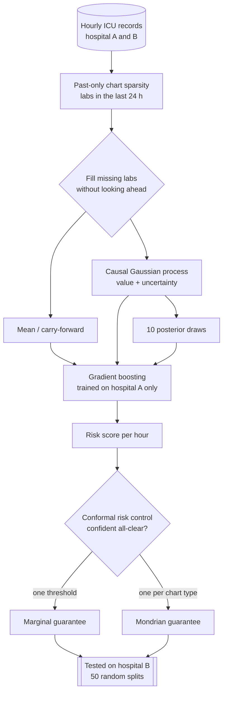
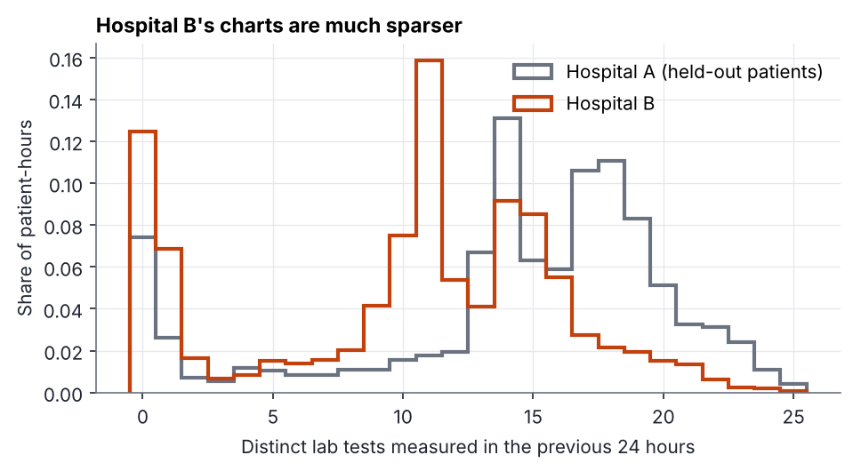
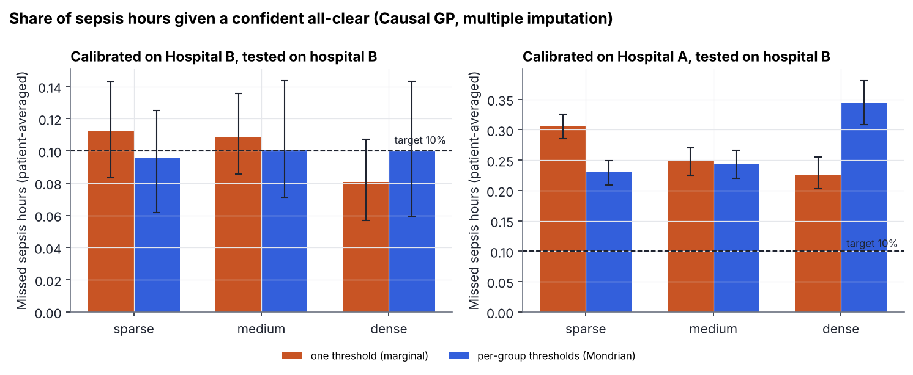
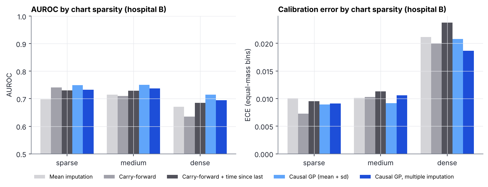
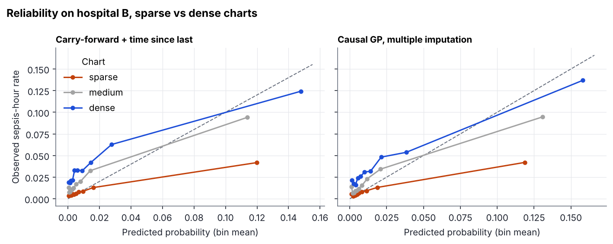
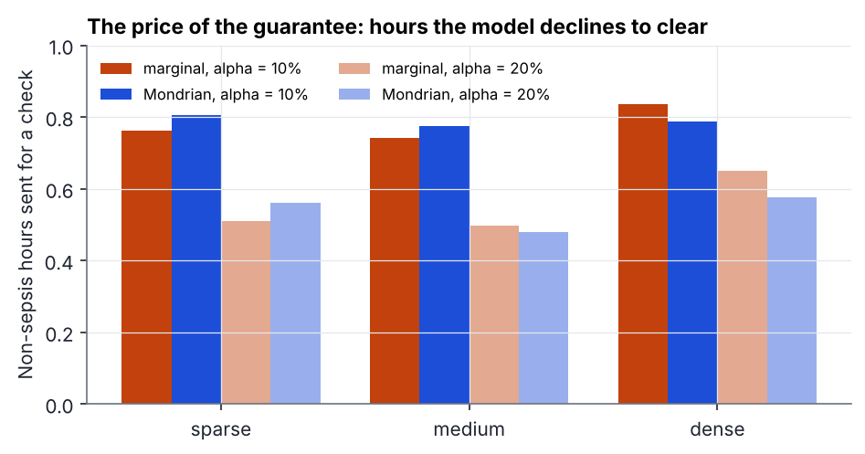

<p align="center">
  
</p>

<p align="center">
  
  
  
  
  
</p>

<p align="center"><b>Uncertainty-aware early sepsis warning when lab data are sparse, tested on a hospital the model has never seen.</b></p>

If an early-warning model is trained in one hospital and moved to another that orders far fewer laboratory tests, how much of its performance survives, and can we still guarantee how many sepsis hours it will wrongly clear? SepsisShift answers this on 40,336 ICU stays from two hospital systems. Every model is trained only on hospital A; hospital B is the external site.

**[Open the interactive dashboard](https://aishwaryasrivastav31.github.io/sepsisshift/)** to explore the results, including the guarantee under every setting. The full write-up is in [REPORT.md](REPORT.md) and the [technical report (PDF)](reports/SepsisShift_Technical_Report.pdf).

## At a glance

| | Hospital A | Hospital B (new) |
|:--|:--:|:--:|
| Median distinct labs in the last 24 h | **16** | **11** |
| Patient-hours with a sparse chart | 42.4% | **75.1%** |
| Best AUROC (95% CI) | 0.818 (0.801–0.831) | **0.747** (0.734–0.760), causal GP |
| Sepsis hours wrongly cleared, 10% target, threshold from A | — | **27.4%** |
| Same, after recalibrating on B, per chart type | — | **9.6–10.0%** |

<p align="center">
  
</p>

## How it works



The causal Gaussian process is the key idea: a lab measured an hour ago is trusted almost fully, while one measured two days ago drifts back towards the population average and carries a larger uncertainty, which the model can use.

## Key findings

| | Hospital A (held-out patients) | Hospital B (external) |
|---|---|---|
| Median distinct labs in the previous 24 h | 16 | 11 |
| Share of patient-hours with a sparse chart | 42.4% | 75.1% |
| Best AUROC (95% CI) | 0.818 (0.801–0.831), causal GP with multiple imputation | 0.747 (0.734–0.760), causal GP |
| AUROC of carry-forward + time-since-last | 0.816 | 0.720 |

1. **Hospital B is much sparser.** Several blood-gas labs are measured at 2–20% of hospital A's rate (BaseExcess 0.022x, HCO3 0.023x, Chloride 0.074x, FiO2 0.16x, pH 0.19x).
2. **All models lose discrimination at the new hospital.** AUROC falls from 0.78–0.82 on hospital A to 0.70–0.75 on hospital B.
3. **Causal GP imputation transfers best.** With the GP posterior mean and standard deviation as features, AUROC on hospital B is 0.747, against 0.720–0.726 for carry-forward models and 0.698 for mean imputation. On hospital A the carry-forward and GP methods are almost tied (0.805–0.818).
4. **Calibration shifts by chart density.** On hospital B, sparse-chart hours are over-predicted and dense-chart hours are under-predicted. Calibration error on dense charts (ECE about 0.019–0.024) is roughly twice that on sparse or medium charts.
5. **A guarantee calibrated at the old hospital fails at the new one.** With thresholds set on hospital A at a 10% target, 21–41% of sepsis hours at hospital B receive a confident all-clear, and the target is missed in every one of 50 random splits.
6. **Recalibrating on hospital B restores the target, and per-group (Mondrian) thresholds hold it within each sparsity group.** With one shared threshold the sparse or medium group can sit above target (for example 11.3% for GP-MI on sparse charts, 13.6% for carry-forward + time-since on medium charts). Per-group thresholds bring every group to between 9.4% and 10.1% on average.
7. **The guarantee is expensive.** At a 10% target, 71–80% of non-sepsis hours at hospital B are not cleared and would need a check. At a 20% target this falls to 49–59%. The causal GP model clears the most hours at the same guarantee (71.3% sent for a check versus 77.5% for carry-forward + time-since).

<p align="center">
  
  
</p>

<details>
<summary><b>Method in detail</b></summary>

- **Unit of analysis:** the patient-hour, with patient-level splits. Hospital A: 70% train (14,235 patients), 30% held-out (6,101). Hospital B: 20,000 patients, never used for training.
- **Sparsity groups:** number of distinct lab tests measured in the previous 24 hours, using only the past. Tertile cut-offs from hospital A training data: sparse (14 or fewer), medium (15–18), dense (more than 18).
- **Imputation, all causal (no look-ahead):**
  - mean imputation;
  - last observation carried forward;
  - carry-forward plus hours since the last measurement;
  - causal Gaussian-process (Ornstein–Uhlenbeck) imputation conditioned on the last measurement, giving a posterior mean and standard deviation that grows with time since the last test;
  - GP multiple imputation, 10 posterior draws per hour, predictions averaged.
- **Classifier:** histogram gradient boosting on 33 clinical variables (vitals and labs) and six context features (age, sex, ICU unit, admission timing) plus the imputation features.
- **Evaluation:** AUROC and AUPRC with patient-cluster bootstrap CIs, equal-mass expected calibration error, reliability curves by sparsity group.
- **Guarantee:** patient-level conformal risk control (Angelopoulos et al., 2024). The controlled risk is the share of a septic patient's sepsis hours that receive a confident all-clear. Thresholds are set either on hospital A or on a random half of hospital B, in one shared (marginal) or per-group (Mondrian) form, and tested on the other half of hospital B over 50 random splits.

</details>

<details>
<summary><b>More figures</b></summary>

<p align="center">
  
  
  
</p>

</details>

<details>
<summary><b>Reproducing the study</b></summary>

1. Download the training data (`training_setA`, `training_setB`) from the [PhysioNet Challenge 2019 page](https://physionet.org/content/challenge-2019/) and place both folders under `data/raw/`.
2. Install and run:

```bash
pip install -r requirements.txt
python run_all.py          # about 10 minutes for stage 1 and 9 minutes for stage 2 on a CPU
pytest -q
```

Stage 1 caches imputed features and scores in `data/cache/`; `python run_all.py --retrain` forces it again. The seed is fixed (2019), so tables are reproducible.

</details>

<details>
<summary><b>Repository layout</b></summary>

```
sepsisshift/
├── run_all.py                    # runs the whole study
├── src/sparseguard/
│   ├── config.py                 # variables, seeds, splits, alphas
│   ├── data.py                   # loading, patient splits, past-only lab counts, sparsity groups
│   ├── impute.py                 # causal OU Gaussian-process imputation
│   ├── features.py               # feature matrices for each imputation method
│   ├── model.py                  # gradient boosting classifier
│   ├── pipeline.py               # stage 1: impute, train, score
│   ├── conformal.py              # conformal risk control, marginal and Mondrian
│   ├── evaluate.py               # discrimination, calibration, conformal experiment
│   └── figures.py
├── tests/test_sparseguard.py     # 9 unit tests
├── reports/
│   ├── tables/                   # every number in the report
│   └── figures/
└── REPORT.md
```

</details>

## Limitations

- Two hospital systems only. The direction of the shift (B sparser than A) is one case, not a general law.
- The challenge sepsis label is defined from Sepsis-3 criteria with a 6-hour look-ahead window, and is shifted to give early warning. Results describe this label, not bedside diagnosis.
- Conformal guarantees hold on average over patients and calibration draws, not for every split; the tables report the share of splits above target.
- Check rates are high. A 10% miss target leaves most non-sepsis hours uncleared, so the method is a triage aid, not an alarm system.

## Data and licence

Data: Reyna MA et al., "Early Prediction of Sepsis From Clinical Data: The PhysioNet/Computing in Cardiology Challenge 2019", *Critical Care Medicine* 48(2), 2020, available on PhysioNet under its data licence. The data are not included in this repository.

Code: MIT licence.
