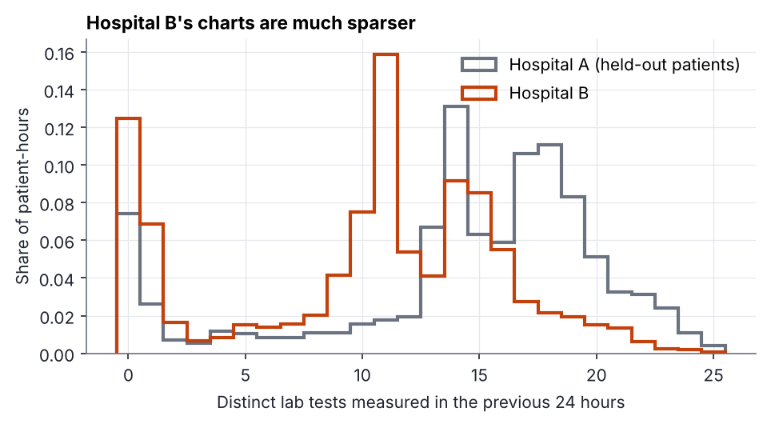
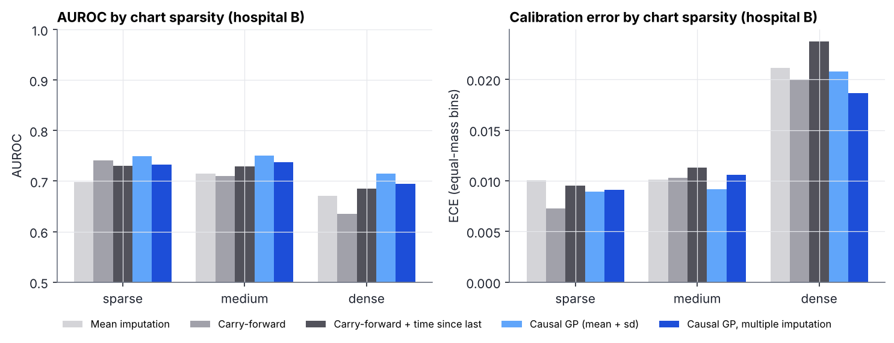
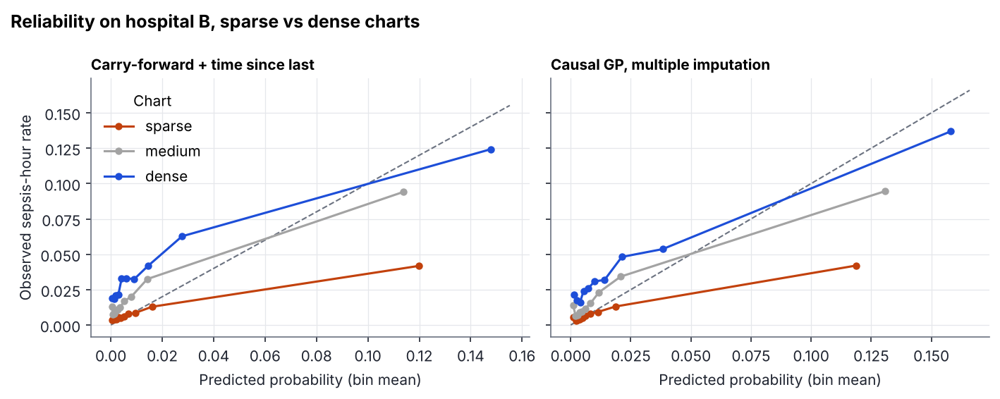
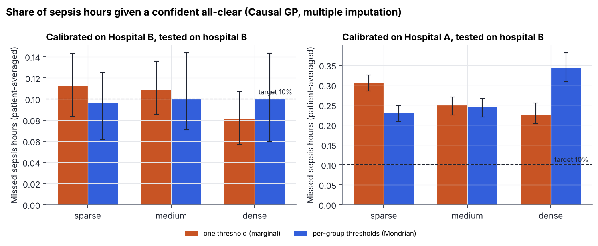
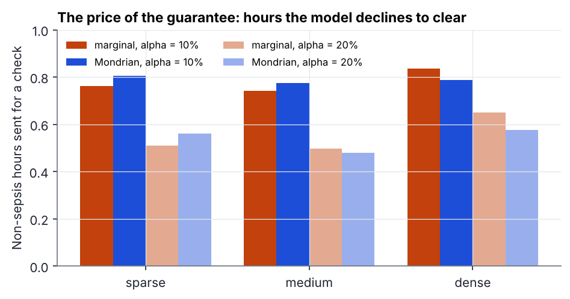

# SepsisShift: Uncertainty-Aware Early Sepsis Warning under Lab Sparsity and Hospital Shift

## Abstract

Early-warning models for sepsis are usually trained in one hospital and then used in others, where clinicians may order far fewer laboratory tests. Missing labs are normally filled in with simple rules, and the model's confidence is rarely checked at the new site. This study measures how much an early-warning model loses when it moves from a lab-rich hospital to a lab-sparse one, whether an uncertainty-aware imputation method transfers better, and whether a conformal guarantee on missed sepsis hours still holds after the move.

Data come from the PhysioNet/Computing in Cardiology Challenge 2019: 40,336 ICU stays and 1,552,210 patient-hours from two hospital systems. Models were trained only on hospital A and tested on held-out hospital A patients and on all 20,000 hospital B patients. Five causal imputation strategies were compared, including an Ornstein–Uhlenbeck Gaussian-process imputation that reports how uncertain each filled-in value is.

Hospital B is much sparser: the median number of distinct labs in the previous 24 hours is 11, against 16 at hospital A, and 75.1% of its patient-hours fall in the sparse group, against 42.4%. AUROC falls from 0.78–0.82 at hospital A to 0.70–0.75 at hospital B. The causal GP model transfers best (AUROC 0.747, 95% CI 0.734–0.760, against 0.720–0.726 for carry-forward models). A conformal threshold set at hospital A for a 10% miss target clears 21–41% of sepsis hours at hospital B and fails in all 50 test splits. Recalibration on hospital B restores the target, and per-group (Mondrian) thresholds hold it within every sparsity group, but at the cost of leaving 71–80% of non-sepsis hours uncleared.

---

## 1. Introduction

### 1.1 Problem

Sepsis is a leading cause of death in intensive care, and every hour of delayed treatment matters. Many hospitals now run early-warning scores that combine vital signs and lab results. Two facts make these models fragile:

1. **Labs are measured irregularly.** A lab such as lactate may be drawn every few hours for one patient and never for another. Before a model can use it, the missing hours must be filled in.
2. **Hospitals differ in how often they test.** A model trained where blood gases are routine may meet a hospital where they are rare. The pattern of missingness itself changes, and so does what a "normal" filled-in value means.

Common imputation rules, such as carrying the last value forward, treat a value measured 40 hours ago as if it were measured now. The model has no way to know that the information is stale.

### 1.2 Research questions

- **RQ1.** How much sparser is the external hospital, and which labs drive the difference?
- **RQ2.** How much discrimination and calibration does each imputation method lose when moved to the external hospital, overall and by chart sparsity?
- **RQ3.** Does a causal Gaussian-process imputation, which reports uncertainty that grows with time since the last test, transfer better than carry-forward rules?
- **RQ4.** Can conformal risk control give a valid guarantee on the share of sepsis hours that are wrongly cleared, at the external hospital and within each sparsity group, and what does that guarantee cost?

### 1.3 Contributions

- A past-only measure of chart sparsity (distinct labs in the previous 24 hours) and an analysis of how it shifts between hospitals.
- A causal OU Gaussian-process imputation that uses only past measurements and gives a posterior mean and standard deviation for every variable and hour, plus a multiple-imputation variant.
- A patient-level conformal risk control procedure for a "confident all-clear" decision, in marginal and Mondrian (per-group) form, tested under hospital shift over 50 random splits.

---

## 2. Data

### 2.1 Source

The PhysioNet/Computing in Cardiology Challenge 2019 training data contain hourly records for ICU patients from two hospital systems, labelled A and B. Each row is one patient-hour with up to 8 vital signs, 26 laboratory values, demographics (age, sex), ICU unit indicators, hospital admission time and ICU length of stay. The label `SepsisLabel` is 1 from six hours before the clinical onset of sepsis (Sepsis-3 criteria) onwards, so a positive prediction is an early warning.

| | Hospital A | Hospital B |
|---|---|---|
| Patients | 20,336 | 20,000 |
| Patient-hours used for evaluation | 235,802 (held-out 30%) | 761,995 |
| Sepsis-hour share | 2.20% | 1.41% |
| Median distinct labs in previous 24 h | 16 | 11 |

Total: 1,552,210 patient-hours across both hospitals.

### 2.2 Splits

All splits are at patient level, so no patient appears in more than one set. Seed 2019.

| Set | Patients | Use |
|---|---|---|
| A_train | 14,235 | Fit imputation parameters, train classifiers, set sparsity cut-offs |
| A_cal | 6,101 | Same-hospital test set; source of hospital-A conformal thresholds |
| B (all) | 20,000 | External test set |
| B_cal / B_test | 10,000 / 10,000 per split | 50 random halves for conformal recalibration and testing |

### 2.3 Variables

33 of the 34 clinical variables were used. End-tidal CO2 (EtCO2) is never recorded at hospital A, so it could not be learned from and was dropped. The variables are HR, O2Sat, Temp, SBP, MAP, DBP, Resp, BaseExcess, HCO3, FiO2, pH, PaCO2, SaO2, AST, BUN, Alkalinephos, Calcium, Chloride, Creatinine, Bilirubin_direct, Glucose, Lactate, Magnesium, Phosphate, Potassium, Bilirubin_total, TroponinI, Hct, Hgb, PTT, WBC, Fibrinogen and Platelets, plus six context features: age, sex, two ICU unit indicators, time from hospital admission to ICU admission, and hours since ICU admission.

### 2.4 Chart sparsity

For each patient-hour, the sparsity score is the number of distinct lab tests (out of 26) measured at least once in the previous 24 hours, counting only the current and past hours. Cut-offs are the tertiles of hospital A training hours:

- **sparse:** 14 or fewer distinct labs;
- **medium:** 15 to 18;
- **dense:** more than 18.

Because the score uses only the past, it can be computed at the bedside in real time and does not leak future information. A unit test checks this.

---

## 3. Methods

### 3.1 Imputation strategies

All five strategies are causal: the value at hour t uses only measurements up to hour t.

| Strategy | Features given to the classifier |
|---|---|
| Mean imputation | Value if measured this hour, otherwise the hospital A training mean (no information about missingness) |
| Carry-forward | Last observed value; left missing if never measured (the trees handle missing values natively) |
| Carry-forward + time since last | Last observed value and hours since it was measured |
| Causal GP (mean + sd) | GP posterior mean and posterior standard deviation |
| Causal GP, multiple imputation | 10 draws from the GP posterior; one prediction per draw, averaged |

### 3.2 Causal Ornstein–Uhlenbeck Gaussian process

Each variable is modelled as a stationary Gaussian process with an exponential (Matérn-1/2, Ornstein–Uhlenbeck) covariance. Conditioning only on the most recent measurement, which is sufficient for a Markov OU process, the correlation between the last measurement and the current hour is

    corr(d) = rho0 * exp(-d / ell),

where d is the number of hours since the last measurement, ell is the length scale and rho0 (between 0 and 1) allows for measurement noise. With population mean mu and standard deviation sigma, the posterior at hour t is

    mean(t) = mu + corr(d) * (x_last - mu)
    sd(t)   = sigma * sqrt(1 - corr(d)^2).

So a value measured just now is trusted almost fully, and as the hours pass the estimate decays towards the population mean while its uncertainty grows towards sigma. A variable never measured for a patient gets the prior (mu, sigma). Values are winsorised at the 0.5th and 99.5th percentiles of hospital A training data before fitting.

**Fitting.** For each variable, ell is chosen by a grid search between 0.5 and 2,000 hours and rho0 by least squares on pairs of consecutive measurements in A_train. Variables with fewer than 100 such pairs keep the prior. Fitted length scales match clinical intuition: vital signs decorrelate within about 7–20 hours (O2Sat 7.5 h, HR 14.1 h, SBP 20.3 h), while slow-moving labs keep information for days (Creatinine 742 h, Bilirubin_total 782 h, Platelets 915 h). Table 01 lists all values.

**Multiple imputation.** For the multiple-imputation model, 10 values are drawn from each hour's posterior. The classifier scores each completed dataset; the final risk is the mean of the 10 predictions. The 90th percentile of the 10 predictions is kept as a pessimistic score.

### 3.3 Classifier

All five strategies feed the same classifier: scikit-learn `HistGradientBoostingClassifier` with learning rate 0.06, up to 400 trees, 31 leaves, minimum 200 samples per leaf, L2 penalty 1.0 and early stopping on a 10% validation slice of A_train. Every model used the full 400 trees. Training stage runtime was 615 seconds on a CPU.

### 3.4 Evaluation of discrimination and calibration

- **AUROC and AUPRC**, with 95% confidence intervals from a patient-cluster bootstrap (100 resamples), so that correlated hours of one patient are resampled together.
- **Expected calibration error (ECE)** with 10 equal-mass bins. Equal-width bins are unsuitable here because almost all predictions sit below 0.05.
- **Brier score.**
- **Reliability curves** for each sparsity group at each hospital.

### 3.5 Conformal risk control for a confident all-clear

The clinical decision studied is a **confident all-clear**: if an hour's risk score is below a threshold tau, the model tells the team that no sepsis check is needed this hour. Every other hour is passed on for a clinical check.

The risk to control is the **missed sepsis share**: for each septic patient, the fraction of their sepsis hours that received an all-clear, averaged over septic patients. Patients, not hours, are treated as exchangeable units, which keeps the guarantee valid even though one patient's hours are strongly correlated.

Following conformal risk control (Angelopoulos et al., 2024), with n septic calibration patients and empirical risk R_n(tau), the threshold is

    tau_hat = max { tau : (n * R_n(tau) + 1) / (n + 1) <= alpha }.

For a new patient exchangeable with the calibration patients, the expected missed share is then at most alpha. Two forms were used:

- **Marginal:** one threshold for all hours.
- **Mondrian:** one threshold per sparsity group, with the loss computed on that group's sepsis hours, so the guarantee holds within each group.

Thresholds were set either on hospital A (A_cal), which tests whether a guarantee survives the move, or on a random half of hospital B, which tests local recalibration. Every setting was evaluated on the other half of hospital B over 50 random patient splits, for alpha = 0.10 and 0.20 and for five scores (carry-forward, carry-forward + time since last, causal GP, GP multiple imputation and its pessimistic variant). The cost of the guarantee is reported as the **check rate**: the share of non-sepsis hours that are not cleared.

### 3.6 Software and tests

Python 3 with NumPy, pandas, scikit-learn and Matplotlib. Nine unit tests check that GP uncertainty grows with time since the last test, that never-measured variables return the prior, that carry-forward never crosses patients, that the sparsity score uses only the past, that splits are patient-level, that the conformal bound holds on calibration data and on fresh exchangeable data, that Mondrian thresholds adapt per group, and that the ECE function behaves correctly. All tests pass.

---

## 4. Results

### 4.1 How much sparser is hospital B? (RQ1)

*Figure 1. Distinct lab tests measured in the previous 24 hours, per patient-hour.*

| | Hospital A (held-out) | Hospital B |
|---|---|---|
| Median distinct labs, previous 24 h | 16 | 11 |
| Share of hours: sparse | 42.4% | 75.1% |
| Share of hours: medium | 33.9% | 19.0% |
| Share of hours: dense | 23.7% | 5.9% |
| Sepsis-hour share: sparse | 1.55% | 0.99% |
| Sepsis-hour share: medium | 2.06% | 2.25% |
| Sepsis-hour share: dense | 3.56% | 4.06% |

The shift is concentrated in blood-gas and electrolyte panels. Relative to hospital A, hospital B records BaseExcess at 0.022 times the rate, HCO3 at 0.023, Chloride at 0.074, FiO2 at 0.16, pH at 0.19, PTT at 0.20 and PaCO2 at 0.26. A few tests are recorded more often at hospital B, notably Glucose (1.8 times) and TroponinI (about 15 times, from a very low base). Dense charts carry the highest sepsis rate at both hospitals, which is expected: sicker patients are tested more.

### 4.2 Discrimination and calibration (RQ2, RQ3)

| Model | AUROC, A | AUROC, B (95% CI) | AUPRC, A | AUPRC, B | ECE, A | ECE, B |
|---|---|---|---|---|---|---|
| Mean imputation | 0.785 | 0.698 (0.682–0.712) | 0.103 | 0.055 | 0.0039 | 0.0089 |
| Carry-forward | 0.805 | 0.726 (0.713–0.739) | 0.112 | 0.055 | 0.0050 | 0.0079 |
| Carry-forward + time since last | 0.816 | 0.720 (0.708–0.734) | 0.113 | 0.054 | 0.0051 | 0.0099 |
| Causal GP (mean + sd) | 0.817 | **0.747 (0.734–0.760)** | 0.112 | **0.059** | 0.0046 | 0.0087 |
| Causal GP, multiple imputation | **0.818** | 0.736 (0.723–0.749) | **0.118** | 0.057 | **0.0028** | 0.0085 |

At hospital A the four non-trivial methods are within 0.013 AUROC of each other, and the bootstrap intervals overlap. At hospital B the order changes. Carry-forward + time since last, which was second best at home, falls to 0.720. The causal GP keeps the highest AUROC at 0.747, and its interval does not overlap that of carry-forward + time since last (0.708–0.734). A plausible reason is that "hours since last test" means something different at a hospital that tests less: long gaps are normal at hospital B, but at hospital A they were a signal. The GP turns elapsed time into a bounded loss of information instead, which seems to travel better.

Multiple imputation gives the best calibration at hospital A (ECE 0.0028) but not the best AUROC at hospital B. Averaging predictions over draws smooths the score; at the new site that smoothing helps calibration slightly but costs some ranking power.

AUPRC values are low in absolute terms because only 1.4–2.2% of hours are positive; each should be compared with its base rate.

*Figure 2. AUROC and calibration error by chart sparsity at hospital B.*

| Hospital B, AUROC | Sparse | Medium | Dense |
|---|---|---|---|
| Mean imputation | 0.698 | 0.714 | 0.671 |
| Carry-forward | 0.741 | 0.710 | 0.635 |
| Carry-forward + time since last | 0.730 | 0.730 | 0.685 |
| Causal GP (mean + sd) | **0.749** | **0.751** | **0.715** |
| Causal GP, multiple imputation | 0.733 | 0.737 | 0.694 |

The causal GP has the highest AUROC in every group at hospital B. Against expectation, the **dense** group, not the sparse group, is hardest at the new hospital (AUROC 0.635–0.715), and its calibration error is about twice that of the other groups (ECE 0.019–0.024 against 0.007–0.011). Dense charts are only 5.9% of hospital B hours, and a densely tested patient at hospital B is likely to be unusually ill, so this group is the one that differs most from what the model learned.

*Figure 3. Reliability at hospital B by sparsity group.*

The reliability curves show the direction of the miscalibration. At hospital B, sparse-chart hours are **over-predicted** (observed rates below the diagonal), while dense-chart hours are **under-predicted** at low and middle predicted risk. A single overall calibration figure hides both errors because they partly cancel.

### 4.3 Conformal guarantee under hospital shift (RQ4)

Results below are means over 50 random splits of hospital B; numbers in brackets are 5th–95th percentiles across splits. "Over target" is the share of splits in which the missed share exceeded alpha.

**Thresholds calibrated on hospital A, tested on hospital B, alpha = 0.10:**

| Score | Mode | Missed share, all | Sparse | Medium | Dense | Over target |
|---|---|---|---|---|---|---|
| Carry-forward + time since | marginal | 31.3% | 30.9% | 34.4% | 30.8% | 100% |
| Carry-forward + time since | Mondrian | 28.8% | 25.7% | 30.1% | 40.8% | 100% |
| Causal GP (mean + sd) | marginal | 28.6% | 30.3% | 28.3% | 23.1% | 100% |
| Causal GP, multiple imputation | marginal | 27.4% | 30.6% | 24.9% | 22.6% | 100% |
| Causal GP, multiple imputation | Mondrian | 25.2% | 23.0% | 24.4% | 34.4% | 100% |

A guarantee calibrated at the source hospital does not survive the move. With a 10% target, 21–41% of sepsis hours at hospital B receive a confident all-clear, depending on the score and group, and the target is missed in every split for every score and mode. The reason is visible in Section 4.2: hospital B's scores are lower overall, so a threshold that left 10% of sepsis hours below it at hospital A leaves far more below it at hospital B. Per-group thresholds from hospital A make the dense group worse (34–41% missed), because the dense group shifts the most.

**Thresholds recalibrated on half of hospital B, tested on the other half, alpha = 0.10:**

| Score | Mode | All | Sparse | Medium | Dense | Check rate |
|---|---|---|---|---|---|---|
| Carry-forward + time since | marginal | 10.0% | 8.4% | **13.6%** (98% over) | 10.2% | 77.5% |
| Carry-forward + time since | Mondrian | 9.4% | 9.7% | 10.0% | 10.1% | 77.7% |
| Causal GP (mean + sd) | marginal | 10.0% | 10.0% | 11.6% (82% over) | 7.4% | **71.3%** |
| Causal GP (mean + sd) | Mondrian | 9.7% | 9.8% | 9.8% | 10.0% | 72.7% |
| Causal GP, multiple imputation | marginal | 9.9% | **11.3%** (70% over) | 10.9% (70% over) | 8.1% | 76.2% |
| Causal GP, multiple imputation | Mondrian | 9.1% | 9.6% | 10.0% | 10.0% | 79.9% |

*Figure 4. Missed sepsis share by group, marginal against Mondrian thresholds, calibrated on hospital B (left) or hospital A (right). Error bars: 5th–95th percentile over 50 splits.*

Local recalibration restores the overall guarantee: every score lands at 9.1–10.0% missed overall. A single shared threshold, however, can leave one group above target in most splits: the medium group for carry-forward + time since last (13.6%, over target in 98% of splits), and the sparse group for GP multiple imputation (11.3%, 70% of splits). Mondrian thresholds fix this: across all scores, every group's mean missed share is between 9.4% and 10.1% at alpha = 0.10, and between 19.5% and 20.5% at alpha = 0.20. With the mean at the target, about 35–60% of individual splits sit slightly above it, which is the expected behaviour of an average-case guarantee rather than a failure.

### 4.4 The cost of the guarantee

*Figure 5. Share of non-sepsis hours at hospital B that are not cleared (GP multiple imputation, hospital-B calibration).*

| Score (hospital B calibration, marginal) | Check rate, alpha 0.10 | Check rate, alpha 0.20 |
|---|---|---|
| Carry-forward | 74.9% | 54.2% |
| Carry-forward + time since | 77.5% | 56.8% |
| Causal GP (mean + sd) | **71.3%** | **49.2%** |
| Causal GP, multiple imputation | 76.2% | 51.6% |

At the same guaranteed miss rate, the causal GP score clears the most hours: at alpha = 0.10, 28.7% of non-sepsis hours receive an all-clear, against 22.5% for carry-forward + time since last. This is the practical value of its better ranking at hospital B. Mondrian thresholds cost little overall (0.2–3.7 percentage points more checks) and move checks between groups: for GP multiple imputation they lower the dense-group check rate (83.7% to 78.8%) and raise the sparse-group rate (76.1% to 80.6%).

Even so, the absolute numbers are sobering. To keep missed sepsis hours at 10%, between 71% and 80% of non-sepsis hours must still be checked. At 20% the figure is 49–59%. With the discrimination achievable here (AUROC around 0.75), a strict guarantee buys only a modest reduction in workload.

---

## 5. Discussion

### 5.1 Main messages

1. **Imputation choice matters more at the new hospital than at home.** At hospital A the methods are nearly tied; at hospital B the gap between best and worst non-trivial method is 0.027 AUROC, and the method ranking changes. Validating only on the training hospital would have hidden this.
2. **Encoding staleness as uncertainty transfers better than encoding it as elapsed time.** Carry-forward + time since last uses the gap length directly, and gap lengths shift with testing habits. The GP translates the gap into a bounded loss of information with a learned, variable-specific length scale.
3. **Guarantees do not transfer.** A conformal threshold is only as valid as the exchangeability between calibration and deployment. Under a documented shift in testing practice, a hospital-A threshold underestimates misses by a factor of two to four. Any deployment needs a local calibration set.
4. **Group-conditional guarantees are cheap and worth having.** With local data, Mondrian thresholds keep every sparsity group at the target for little extra overall workload.

### 5.2 Limitations

- **Two hospitals.** Only one direction of shift (towards fewer tests) is observed. A third site would show whether the GP advantage is general.
- **Label definition.** The challenge label marks hours from six hours before Sepsis-3 onset. The study evaluates hourly ranking against this label; it does not measure time-to-alarm or clinical outcomes.
- **Simple GP.** Each variable has its own univariate OU process conditioned on the last value only. Multi-output GPs that share information across labs, or models with time-varying means, may do better.
- **Average-case guarantee.** Conformal risk control bounds the expected missed share. It does not promise that every calibration draw meets the target, and it assumes patients in the calibration and test halves are exchangeable, which holds for random halves of one hospital but not across hospitals.
- **High check rates.** The method is a triage aid. It cannot reduce workload much while discrimination stays near 0.75.
- **Single run.** The classifier was trained once with a fixed seed; variance across training seeds was not measured.

### 5.3 Future work

- Combine the GP posterior with a model trained on missingness indicators, so the classifier can learn the testing pattern without depending on it.
- Weighted conformal prediction using estimated sparsity-shift weights, to adapt hospital-A thresholds without labelled hospital-B data.
- Evaluate at patient level with alarm lead time and alarm burden per patient-day.

---

## 6. Conclusion

When an early sepsis warning model moves from a lab-rich hospital to one that tests far less, its ranking performance falls by 0.07–0.10 AUROC, its calibration breaks in opposite directions for sparse and dense charts, and a missed-sepsis guarantee calibrated at the old hospital no longer holds. A causal Gaussian-process imputation that turns time since the last test into uncertainty is the most robust of the strategies tested, with the best AUROC at the new hospital in every sparsity group and the lowest workload at a fixed guarantee. Local recalibration with per-group conformal thresholds restores the guarantee within every group, but the price is that most non-sepsis hours still need a check.

---

## References

- Angelopoulos, A. N., Bates, S., Fisch, A., Lei, L., and Schuster, T. (2024). Conformal risk control. *International Conference on Learning Representations*.
- Reyna, M. A., Josef, C. S., Jeter, R., et al. (2020). Early prediction of sepsis from clinical data: the PhysioNet/Computing in Cardiology Challenge 2019. *Critical Care Medicine*, 48(2), 210–217.
- Singer, M., Deutschman, C. S., Seymour, C. W., et al. (2016). The third international consensus definitions for sepsis and septic shock (Sepsis-3). *JAMA*, 315(8), 801–810.
- Vovk, V., Gammerman, A., and Shafer, G. (2005). *Algorithmic Learning in a Random World*. Springer.

---

## Appendix A. Output tables

| File | Contents |
|---|---|
| `00_run_meta.json` | Patients per split, sparsity cut-offs, variables used, runtimes |
| `01_gp_hyperparameters.csv` | Fitted GP mean, sd, rho0 and length scale per variable |
| `10_hospital_shift.csv` | Group shares and sepsis rates per hospital |
| `11_lab_measurement_rates.csv` | Measurement rate of each lab at each hospital and the B/A ratio |
| `20_discrimination_calibration.csv` | AUROC, AUPRC, ECE, Brier by model, hospital and group, with CIs |
| `21_reliability.csv` | Reliability curve points |
| `30_conformal_by_split.csv` | Every conformal result for every split |
| `31_conformal_summary.csv` | Means, percentiles and share over target across splits |
